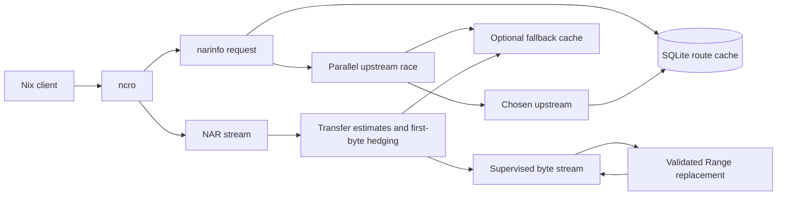
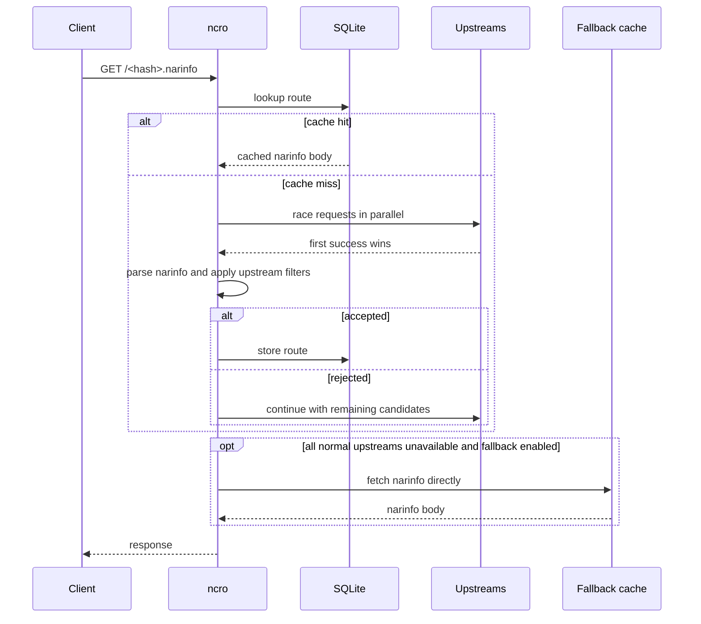
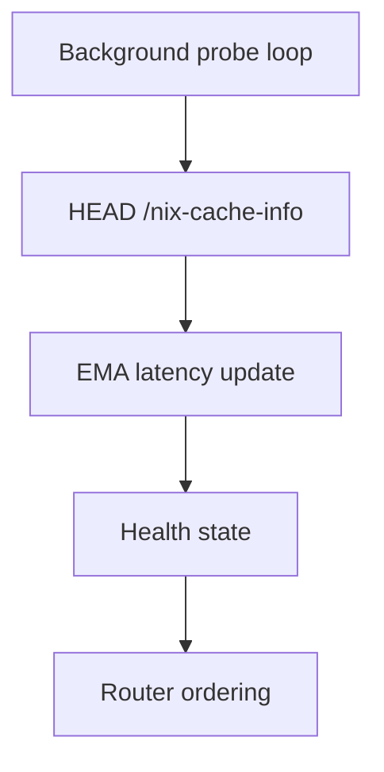
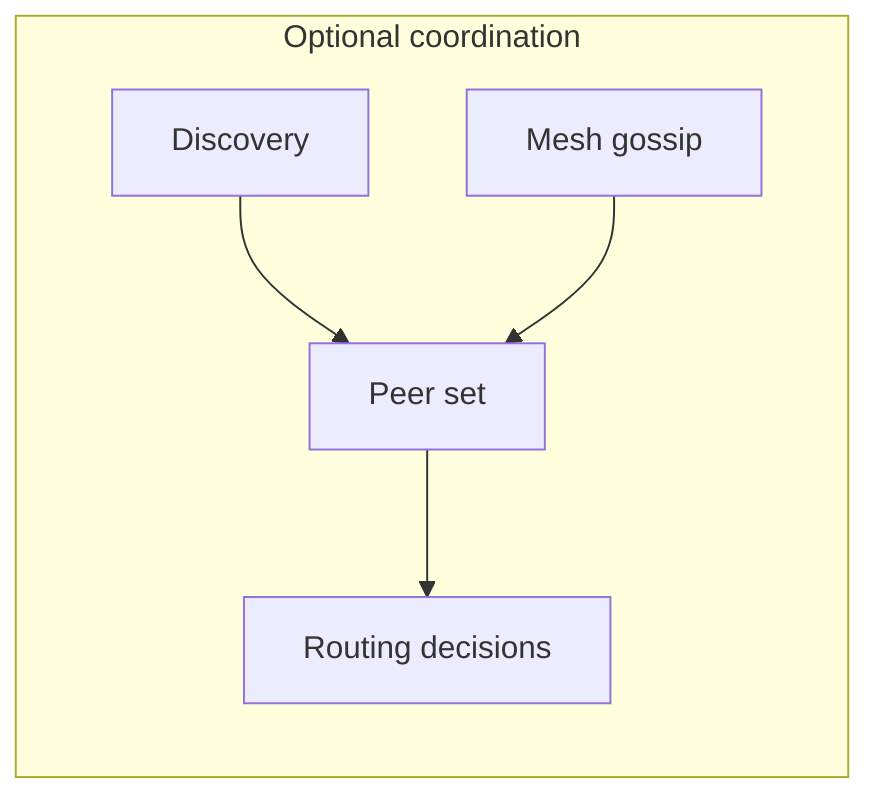

# Architecture

`ncro` is a Nix cache router. It sits in front of one or more upstream caches,
learns which upstream answers fastest for a given path, and reuses that decision
until it expires.



The routing path is simple: a narinfo lookup first checks SQLite, then falls
back to a parallel race across upstreams when there is no usable entry. The
winning upstream is stored with a TTL, so later requests can skip the race. If
all normal upstreams are unavailable, ncro can use a separately configured
fallback cache as a last resort.



Path filters sit after the narinfo fetch, not before the upstream race. A Nix
client requests `/<hash>.narinfo`, so ncro only knows the store hash at the
start of routing. The full `StorePath`, references, and deriver are inside the
narinfo body. This means filtering is a validation step for candidate winners:
if a winning upstream's narinfo is rejected, the route is not cached and ncro
retries the remaining candidates.

> [!NOTE]
> The fallback cache is deliberately outside this path. It is not an upstream in
> the router's candidate set and is not affected by filters, priority,
> discovery, cooldown, health state, or route-cache persistence. This gives
> operators a direct recovery path to a known-good cache if the normal router
> behavior or all configured upstreams are unavailable.

NAR transfer selection is separate from narinfo routing. Within configured
priority groups, fresh measured first-byte time and throughput estimate NAR
completion time using the remaining compressed file size. With no usable
measurement, the cached route and health latency provide the fallback order.
First-byte hedging remains available. NAR transfer decisions never replace the
narinfo route in SQLite.

The body supervisor works for HTTP and S3 streams. It learns only from actively
awaited upstream reads, not downstream polling pauses, and does not prefetch
whole files or write NARs to disk. Transfer statistics are process-local,
freshness-limited, and conservatively adjusted for active requests. The bounded
registry is independent of the persisted HEAD-probe health estimates.

```mermaid
sequenceDiagram
  participant C as Nix client
  participant N as ncro supervisor
  participant U as Initial source
  participant A as Eligible alternate

  C->>N: GET NAR or byte range
  N->>U: Request selected source
  opt First-byte deadline exceeded
    N->>A: Hedge request
  end
  U-->>N: Successful first body chunk
  N-->>C: Original headers and streamed prefix
  alt Stall, body error, or premature EOF
    N->>A: Discover matching metadata; GET remaining Range
    A-->>N: Exact 206 Content-Range and first chunk
    N-->>C: Continue same response at committed offset
  else Sustained slow upstream reads
    N->>A: Discover; sample bounded remaining-range prefix
    alt Completion-time improvement exceeds both thresholds
      N->>U: Cancel original stream
      N-->>C: Retained alternate prefix and remaining stream
    else Insufficient improvement or invalid response
      N->>A: Cancel probe
      N-->>C: Continue original stream
    end
  end
```

Resuming properly requires identical compressed-file metadata, including a
usable `FileHash` and positive `FileSize`. We cannot use a matching uncompressed
`NarHash` alone to establish byte identity. Replacement ranges must match the
_exact_ absolute cursor, requested end, and total size. Client status/headers
remain those of the initial response. Missing metadata, unsafe ranges, or
exhausted recovery terminate the body with an error rather than splice unchecked
bytes. Nix retains its normal integrity verification.

Slow-stream exploration pauses the current cursor, retains at most the
configured probe prefix plus one transport chunk, and continues the same
replacement connection on success. Time and attempt limits bound exploration;
absolute and fractional savings thresholds prevent marginal switches. Each
source can be attempted only once after the initial selection, and client
cancellation drops all owned streams. `allow_hedging = false` excludes
additional requests. Fallback-cache traffic is outside adaptive transfer
measurement and recovery; it remains a last resort before downstream streaming
starts.

Background health probes keep latency estimates current by calling
`HEAD /nix-cache-info` every 30 seconds. The health layer uses Exponentially
Weighted Moving Average (EMA) smoothing, so a single bad probe does not
immediately dominate the routing decision:

$$
L_t = \alpha \cdot R_t + (1 - \alpha) \cdot L_{t-1}
$$

Where $R_t$ is the latest observed latency, $L_t$ is the new estimate, and
`alpha` (`cache.latency_alpha`, default `0.3`) controls how quickly the estimate
adapts. Higher values react faster to real changes; lower values filter out
noise.



Narinfo selection is driven by latency first. When two upstreams are effectively
tied, `priority` breaks the tie. The router also tracks failures and probe
volume so it can distinguish a briefly slow cache from one trending unhealthy.
NAR selection additionally uses its separate, expiring transfer estimates.
Per-upstream filters can reject a candidate winner after its narinfo is fetched;
this prevents project-specific caches from becoming winners for unrelated paths.
Fallback cache traffic bypasses these router features and does not update health
or routing state.

> [!NOTE]
> Persistence is intentionally narrow. SQLite stores two kinds of data so a
> restart does not force ncro to relearn everything from scratch.

First type of stored data is **route entries**, a mapping from narinfo hash to
the winning upstream URL, stored with a creation timestamp and TTL. When the
cache exceeds `max_entries`, the least recently used entry is evicted first.
**Health snapshots** on another hand are per-upstream EMA latency estimates and
failure counts, refreshed by the background probe loop. Fallback-cache responses
are (intentionally) not stored as route entries, so normal upstreams become
active again as soon as they recover.

Discovery and mesh are optional extensions. Discovery can add peers from the
local network, while mesh gossip shares recent route decisions across trusted
nodes using signed UDP packets. Consider:



At runtime, ncro loads config, validates it, opens SQLite, seeds health state,
starts background loops, and finally binds the HTTP listener. The HTTP server
and all background tasks run on tokio's async runtime, allowing concurrent
upstream connections without thread-per-connection overhead. Shutdown is driven
by the normal process termination path and background work is told to stop
gracefully.
